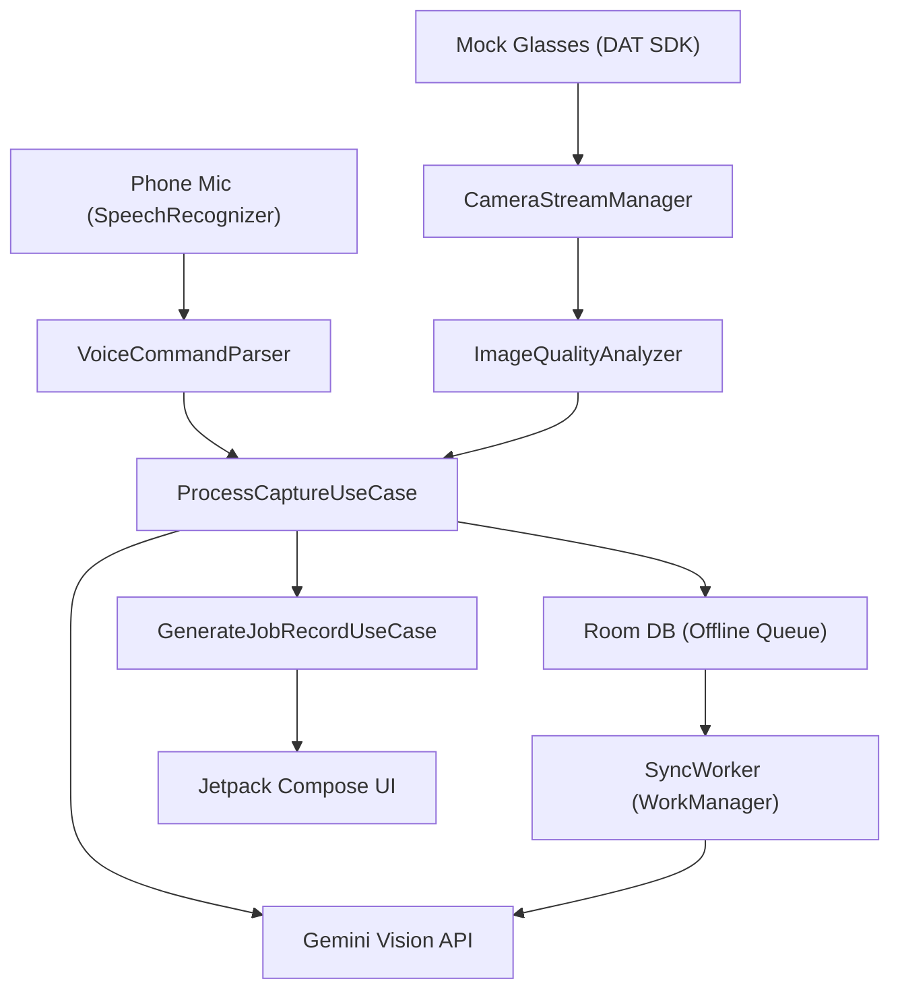

# FieldCapture

> Hands-free field inspection on AI glasses — turning a technician's walk-through into structured job records and draft estimate line items.

## What It Does

FieldCapture is an Android (Kotlin + Jetpack Compose) application built on Meta's Device Access Toolkit (DAT SDK `1.0.1`) using the Mock Device Kit. As a technician inspects a damaged property, continuous voice commands trigger frame capture, on-device image quality gating, and structured vision extraction via the Google Gemini API. Offline-resilient local storage (Room + WorkManager) queues captures when connectivity drops and exports a versioned JSON `JobRecord` (`schema_version: 1.0.0`) mapped to 15 restoration line-item codes.

---

## Quick Start (< 10 minutes)

### Prerequisites
- Android Studio Hedgehog (`2023.1.1`) or newer
- Android SDK `35` (`compileSdk = 35`, `targetSdk = 35`)
- Physical Android device or emulator running **Android 10+ (API 29+)** *(required by `mwdat-camera:1.0.1`)*
- One or more free Google Gemini API keys from [aistudio.google.com](https://aistudio.google.com/apikey)

### Setup
1. **Clone the repository:**
   ```bash
   git clone https://github.com/Prashanf/FieldCapture.git
   cd FieldCapture
   ```

2. **Add your Gemini API key(s) in `FieldCapture/local.properties` (gitignored):**
   ```properties
   GEMINI_API_KEY_1=your_first_key_here
   # Optional additional keys for zero-backoff rotation on HTTP 429 limits:
   GEMINI_API_KEY_2=your_second_key_here
   GEMINI_API_KEY_3=your_third_key_here
   ```
   *(Single `GEMINI_API_KEY=...` is also supported; `app/build.gradle.kts` exposes all keys via `BuildConfig.GEMINI_API_KEYS` and keeps `BuildConfig.GEMINI_API_KEY` for compatibility.)*

3. **Open, build, and install:**
   - Open `FieldCapture/` in Android Studio, let Gradle sync (`mwdat-*:1.0.1` resolves from Maven Central; Developer Mode metadata is pre-configured in `AndroidManifest.xml`), select your device, and click **Run**.
   - Or install from CLI using Gradle (`9.1.0+`) + `adb`:
     ```bash
     gradle assembleDebug
     adb install -r app/build/outputs/apk/debug/app-debug.apk
     ```

4. **Launch & grant permissions:** Allow **Camera**, **Microphone**, and **Bluetooth / Nearby Devices** when prompted.

5. **Run an inspection session:**
   - Tap **Start Job** → enter Technician Name / optional Address → **Start**.
   - Tap **Start Session** to activate the Mock Device Kit camera feed preview.
   - Tap **Start Listening** and speak voice commands hands-free.

### Voice Commands
- **`"capture nameplate"`** — captures equipment plate and extracts manufacturer, model number, serial number, manufacture date, and capacity.
- **`"capture damage [room] [surface]"`** — e.g., `"capture damage kitchen north wall"` — extracts damage type, severity, affected materials, and suggested line items.
- **`"note [free text]"`** / **`"add note [text]"`** — e.g., `"note leak started Tuesday near dishwasher"` — categorizes field observations, measurements, homeowner statements, and safety concerns.

### Running Tests
```bash
# Unit tests (67 tests across 8 suites via Gradle)
gradle testDebugUnitTest

# Instrumented tests (requires device/emulator + API key in local.properties)
gradle connectedDebugAndroidTest
```

---

## Architecture

### System Architecture (`docs/architecture.md`)


### Package Layout (Actual Codebase)
- `com.fieldcapture.glasses` — `GlassesSessionManager`, `MockDeviceManager`, `CameraStreamManager`, `GlassesState`
- `com.fieldcapture.voice` — `VoiceCommandService`, `VoiceCommandParser`, `AudioFeedbackManager`
- `com.fieldcapture.quality` — `ImageQualityAnalyzer`, `BlurDetector`, `BrightnessAnalyzer`, `FramingAnalyzer`, `QualityThresholds`
- `com.fieldcapture.extraction` — `ExtractionService`, `ExtractionPrompts`, `ExtractionResult`
- `com.fieldcapture.network` — `GeminiApiClient` (multi-key rotation + backoff), `ConnectivityObserver`
- `com.fieldcapture.domain` — Models (`JobRecord`, `LineItemCode`, `Capture`, `VoiceCommand`), repositories, and use cases (`ProcessCaptureUseCase`, `MapToLineItemsUseCase`, `BuildJobRecordUseCase`, `GenerateJobRecordUseCase`, `SyncCapturesUseCase`)
- `com.fieldcapture.data` — Room database (`FieldCaptureDatabase`), DAOs, entities (`CaptureStatus`), repository implementations
- `com.fieldcapture.sync` — `SyncManager`, `ExtractionQueueWorker`, `SyncWorker`, `SyncScheduler`, `ConnectivityMonitor`
- `com.fieldcapture.presentation` — Jetpack Compose UI (`SessionScreen`, `ReviewScreen`, `JobRecordScreen`, `AppNavigation`, shared cards/bars)
- `com.fieldcapture.eval` — `EvalRunner`, `ProgrammaticTestImageGenerator` (+ `androidTest` `SyntheticNameplateGenerator`, `RealPipelineEvalTest`)

### Capture Pipeline Flow
```
Voice Command ("capture ..." / "note ...") → VoiceCommandParser
  → GlassesSessionManager (DAT SDK stream / capturePhoto) → Bitmap
  → ImageQualityAnalyzer (Laplacian blur, mean luminance, Sobel edge density)
      ├─ FAIL → AudioFeedbackManager ("too blurry / too dark / retake") → Wait for next command
      └─ PASS → Save CaptureEntity in Room DB
                  ├─ Online  → ExtractionService → GeminiApiClient (3-key rotation) → Update Room + MapToLineItemsUseCase
                  └─ Offline / 429-all / 5xx → Queue as PENDING → ExtractionQueueWorker (WorkManager) retries when connected
  → Complete Job / Review → BuildJobRecordUseCase / GenerateJobRecordUseCase → JsonExporter (.json)
```

---

## How It Works

### Capture Quality Gate (Pure Android, No OpenCV)
Three deterministic checks in `ImageQualityAnalyzer` run on-device before any network call:
- **`BlurDetector`:** Laplacian variance threshold **`80.0`** (general damage) / **`100.0`** (stricter for nameplate OCR).
- **`BrightnessAnalyzer`:** Mean grayscale luminance between **`30`** (permits crawl spaces/under-sink photos) and **`240`** (tolerates work lights without washed-out glare).
- **`FramingAnalyzer`:** Minimum Sobel edge density **`2.0`** to catch lens obstructions or blank wall frames.

### AI Extraction & API Resilience
- **Direct OkHttp REST Client (`GeminiApiClient`):** Targets **`gemini-3.5-flash`** with automatic fallback to **`gemini-3.8-flash`** and **`gemini-3.5-flash-lite`**, requesting structured JSON with per-field confidence scores.
- **Multi-Key Rotation:** Supports `N` API keys configured in `local.properties` (`GEMINI_API_KEY_1..N`). On HTTP `429 RESOURCE_EXHAUSTED`, `GeminiApiClient` rotates to the next key immediately with **zero backoff**, reserving exponential backoff (`1s`, `2s`, `4s`) for transient `503`/network errors. Throws `AllKeysExhaustedException` only after all keys and models are exhausted.
- **Known API Latency & Reliability Issue:** Under healthy conditions, `gemini-3.5-flash` takes **`~12.3s`** per image, whereas peak-load **`503` spikes and `60s` read timeouts** can stall a single frame for **2–3+ minutes** across retries and burn multiple quota calls per capture (in contrast, `gemini-3.5-flash-lite` responds in **`~2–3s`** per image with zero observed timeouts across 23 frames). Extractions run asynchronously so techs are never blocked while walking, and any timed-out/failed capture queues automatically for WorkManager sync.
- **Offline Queue (`Room` + `WorkManager`):** `ConnectivityObserver` monitors network availability while `ExtractionQueueWorker` (`@HiltWorker`) and `SyncManager` drain `PENDING` captures once connectivity returns.

### Line Item Mapping & Draft Pricing Disclaimer
`MapToLineItemsUseCase` maps extracted damage assessments across **15** standardized restoration `LineItemCode` entries (e.g., `WATER_EXTRACTION`, `REMOVE_REPLACE_DRYWALL`, `MOLD_REMEDIATION`, `STRUCTURAL_DRY_OUT`, `ANTIMICROBIAL_TREATMENT`), each linked to its `source_capture_id`. Unit prices are placeholder industry-range values demonstrating end-to-end draft estimate generation; 3 sample records are in `samples/` and `eval/sample_outputs/`.

---

## Evaluation Results (30 Real Phone Camera Captures)

| Metric | Measured Score | Details |
|--------|---------------|---------|
| Real Captures Evaluated | **30 / 30** completed | `13` Nameplates, `13` Damage, `4` Notes (`eval/test_set/real_captures/`) |
| Quality Gate Filtering | **21 / 30** passed (`70%`) | Caught all blurry/dark retakes (`blur 29.5–54.1`, `bright 7–16`) |
| Nameplate Manufacturer / Serial | **83.3%** (`10/12` fuzzy) | Reads embossed & clear plates; rejects non-equipment packaging (`REAL-NP-004`) |
| Damage Affected Materials | **100.0%** (`13/13`) | `0.78` Line-Item F1 (`83.3%` recall, `79.5%` precision) |
| Note Category / Key Facts | **100%** / **75%** (`4/4`, `3/4`) | High precision on spoken observations, measurements & safety checks |
| Accuracy by Difficulty | **85.0%** Easy / **62.1%** Med / **54.0%** Hard | Bright vs. dim/blurry retake pairs measured directly |

All evaluation metrics come from real camera captures run through `ImageQualityAnalyzer`, `ExtractionService`, 3-key rotated `GeminiApiClient`, and `EvalRunner`. See [`eval/eval_report.md`](eval/eval_report.md) for per-field breakdown, confidence calibration, 5 worst failures, and threshold tuning.

---

## Key Technical Decisions

### Why OkHttp directly instead of the Google AI SDK?
Direct HTTP via OkHttp + Gson provides explicit access to HTTP status codes (`429`, `503`, `404`), three-tier model fallback (`gemini-3.5-flash` → `gemini-3.8-flash` → `gemini-3.5-flash-lite`), request timeouts, and immediate zero-backoff API key rotation that high-level SDK wrappers obscure.

### Why pure Android math instead of OpenCV for quality checks?
Shipping OpenCV native binaries adds ~50 MB to the APK and complicates ABI splits. Pure Kotlin `Bitmap` pixel passes for Laplacian variance, mean luminance, and Sobel edges run fast on-device while keeping dependencies minimal.

### Why real phone captures + programmatic pipeline tests?
Our primary benchmark evaluates **30 genuine phone camera photographs** (`eval/test_set/real_captures/`) captured across varied household appliances, low-contrast embossed plates, dark/motion-blurry retakes, and indoor wall/ceiling/plumbing scenes rather than relying on downloaded stock images. Programmatic `Canvas`/`Paint` bitmaps (`ProgrammaticTestImageGenerator` and `SyntheticNameplateGenerator`) remain available strictly for deterministic offline unit/instrumented code-path tests.

### Mock Device Kit Limitations vs. Real Meta AI Glasses
- **Simulated cleanly:** Paired `GlassesModel.RAYBAN_META` lifecycle (`powerOn`, `don`, `unfold`), `CameraFacing.BACK` or video/image URI feeds, `VideoQuality.MEDIUM` stream preview, and `capturePhoto()` flow.
- **Cannot simulate:** Real glasses ultra-wide peripheral FOV distortion, head movement during walk-through capture, wearable microphone hardware in noisy job sites (replaced here by phone `SpeechRecognizer`), LED/HUD glass cues, or real Meta glasses battery thermal throttling.

---

## What I'd Do With Two More Weeks

1. **On-Device VLM Fallback (`Gemma 3 4B INT4`):** Integrate MediaPipe LLM Inference API for local extraction in network-dead basements and crawl spaces (cloud Gemini multi-key → local VLM → Room/WorkManager queue).
2. **Real Meta Ray-Ban Hardware Testing:** Benchmark latency, wearable mic accuracy next to air movers/dehumidifiers, ultra-wide lens blur thresholds, and battery drain across 30–60 minute sessions.
3. **Depth-Assisted Quantity Estimation:** Fuse camera frames with a compact ToF depth sensor (`VL53L5CX`) so drywall/flooring line items calculate measured square footage instead of visual area guesses.
4. **Severity Calibration:** Fine-tune severity tier boundaries with multi-label calibration examples to eliminate off-by-one `low`/`medium`/`high` drift.
5. **Xactimate & Multi-Room Session Flow:** Track room-to-room walk transitions and export directly to Xactimate ESX-compatible formats.

---

## Tools Used
- **AI Coding Assistant:** Google DeepMind Antigravity (CLI agentic coding workflow)
- **Vision Model:** Google Gemini 3.5 Flash (`gemini-3.5-flash`) with automatic fallback to `gemini-3.8-flash` and `gemini-3.5-flash-lite`
- **API Cost:** `$0` (Google AI Studio Free Tier, `20` requests/day per key × `3` rotated keys)

---

## Documentation
- [`docs/architecture.md`](docs/architecture.md) — Original Mermaid system architecture diagram
- [`docs/assumptions.md`](docs/assumptions.md) — Technical & SDK compatibility assumptions
- [`docs/research_memo.md`](docs/research_memo.md) — 1-page research memo on Meta AI glasses, DAT SDK findings, and hardware roadmap
- [`docs/demo_script.md`](docs/demo_script.md) — 5-minute phone walk-through demo script
- [`eval/eval_report.md`](eval/eval_report.md) — Live 30-capture real-world benchmark report

---

## License
All Rights Reserved. See project repository terms.
